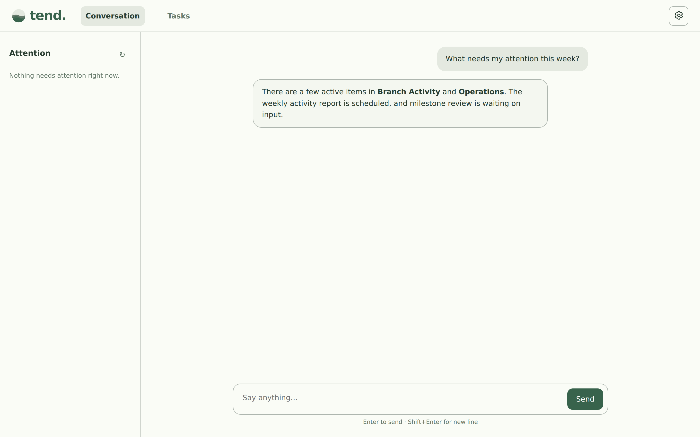
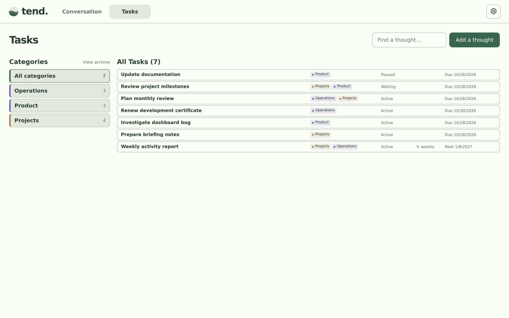
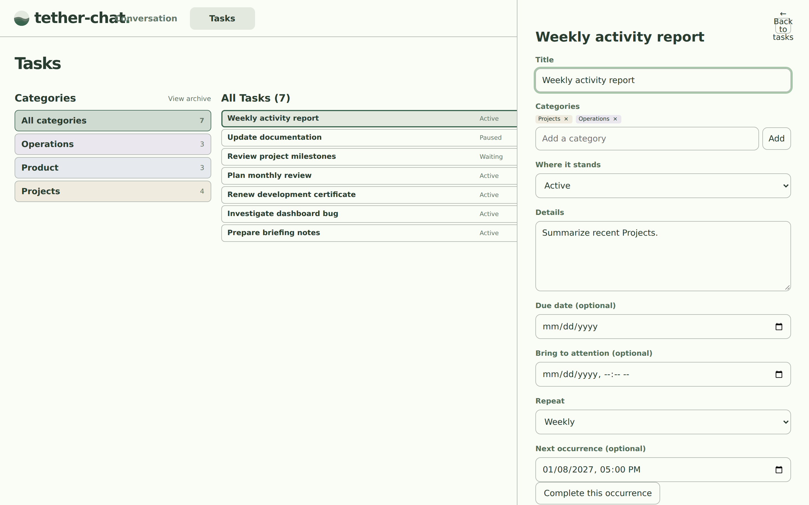
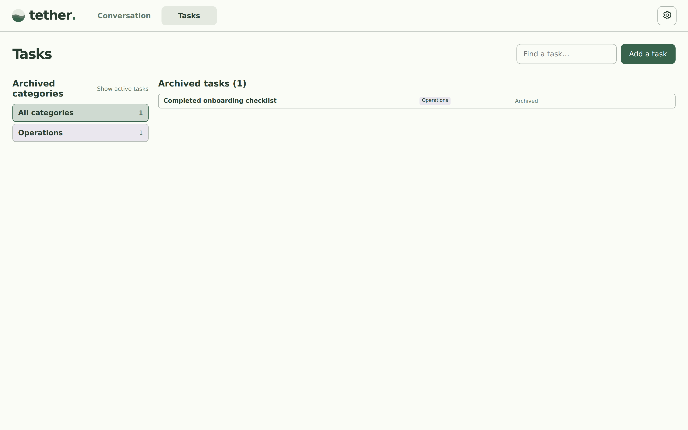

# Tend

Tend is a local-first assistant for keeping track of things you're thinking about, working on, or need to revisit. Talk to it normally; it organizes tasks and remembers context in a local SQLite database.

## Screenshots

The screenshots below use example data, not anyone's personal tasks. They are generated by the [screenshot workflow](.github/workflows/screenshots.yml).

**Conversation**



**Tasks**



**Task details**



**Archive**



## Install on Windows

You need **Python 3.11 or newer**, **Git**, and the **Microsoft Edge WebView2 Runtime** (usually already installed on Windows 10/11).

Open PowerShell:

```powershell
git clone https://github.com/briday1/Tend.git
cd Tend
py -3 -m venv .venv
.\.venv\Scripts\python.exe -m pip install -e .
powershell -ExecutionPolicy Bypass -File .\install-desktop.ps1
```

The installer builds a native **Tend.exe** and creates a **Tend** shortcut on your desktop. Launch Tend from that shortcut. It starts the local services automatically, without requiring an open PowerShell window.

When you close the app window, Tend stays in your system tray. Choose **Open Tend** to reopen it or **Exit Tend** to stop the app and its services.

## First-time setup

Open **Settings → AI connection**. Enter your provider's HTTPS API base URL, model name, and API key, then save and test the connection. The model must support OpenAI-compatible chat-completions tool calling. Your key is stored in your operating system's credential vault, not the Tend database.

## Using Tend

- **Conversation:** Describe things to remember, ask what's outstanding, or tell Tend when something changes.
- **Tasks:** Select a category, search tasks, change statuses and dates, or log activity.
- **Reminders and recurring tasks:** Set *Bring to attention* and repeating schedules. A task can also have a linked activity-report action.
- **Archive:** Put finished or inactive tasks away without deleting them; restore them later.
- **MCP:** Other trusted local tools can access the same Tend data through `http://127.0.0.1:8766/mcp`.

Example things to say: “Remind me to follow up next Thursday,” “What am I waiting on?”, “Summarize the week's Branch Activity,” or “Archive that task.”

## Updating

For ordinary Tend updates, choose **Exit Tend** from the system tray, then run `git pull` inside your Tend folder and relaunch the shortcut. If the **native Windows app or its dependencies** changed, rerun `install-desktop.ps1` to rebuild `Tend.exe`.

## More information

See [detailed documentation and troubleshooting](docs/DEVELOPMENT.md) for server setup, database backups, MCP configuration, development, and debugging.

To refresh the screenshot gallery, run **Actions → Refresh Tend UI screenshots → Run workflow** in GitHub. Screenshots appear here after that workflow generates and commits them.
