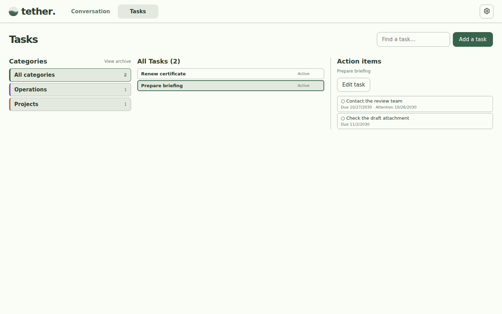
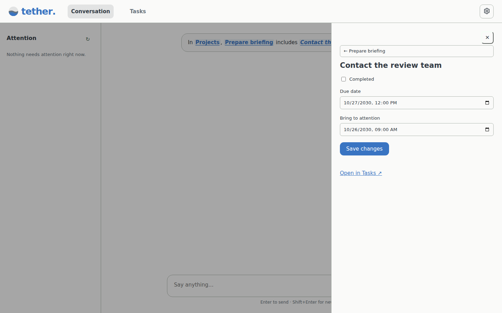

# tether

tether is a local-first assistant for keeping track of things you're thinking about, working on, or need to revisit. Talk to it normally; it organizes tasks and remembers context in a local SQLite database.

## Screenshots

The screenshots below use example data, not anyone's personal tasks. They are generated by the [screenshot workflow](.github/workflows/screenshots.yml).

**Conversation**


**Calendar requested in chat (synthetic example data)**


**Month calendar (weekends appear only when they contain tasks or activity)**


These calendars are generated from local task data and appear inside the assistant's themed chat bubble. Day cells have borders and transparent interiors; task blocks keep their category-colored backgrounds. You can request a calendar naturally with `give me my next week snapshot` or `/snapshot last month`.

**On a phone**


**Tasks**


**Task actions and details**






**Archive**


## Install

Python 3.11 or newer is required. No Git clone, PyInstaller build, or separate Windows executable installer is required.

**Desktop app (recommended):**

```sh
uv tool install "tether[desktop]"
tether-desktop
```

The installation exposes exactly two commands: **`tether`** and **`tether-desktop`**.
On Windows, the desktop command opens a native WebView2 window. Closing the window
hides it; the tray's **Open tether** and **Exit tether** controls reopen it or stop
its owned services. The Microsoft Edge WebView2 Runtime is required. macOS and Linux
use a browser window with a tray/menu-bar entry where supported by the graphical
desktop. Linux may require tray/AppIndicator support. Desktop sessions are required
for tray mode; use the CLI on headless machines.

**Browser/server mode:**

```sh
python -m pip install tether
tether serve --port 9000 --mcp-port 9001
tether serve --no-browser
```

The default browser address is `http://127.0.0.1:8765`; the local MCP server uses
port 8766. Both services are local-only. Ctrl+C stops a terminal-launched instance.
For pip-managed desktop mode, install `python -m pip install "tether[desktop]"`.
Pillow is a core dependency because PNG/SVG exports are available in browser mode too.

**Optional desktop shortcut:** after installing the desktop extra, run:

```sh
tether desktop install
tether desktop install --destination "/path/to/shortcuts"
```

The default destination is the operating system's Desktop folder. Windows gets a
`.lnk` shortcut to the installed windowed Python interpreter with tether's icon;
macOS gets a `.command` launcher, and Linux a `.desktop` entry. A Linux desktop may
require marking the launcher trusted. Keep the Python/uv environment that the
shortcut references. Add `tether-desktop` to your OS login/startup applications to
start it when you sign in; installation does not enable startup automatically.

Existing databases and provider settings stay in `~/.tend` for compatibility.
This does not install a legacy `tend` command.

The older `install-desktop.ps1` workflow remains an optional Windows build method,
not a prerequisite for either installation above.

## First-time setup

Open **Settings → AI connection**. Enter your provider's HTTPS API base URL, model name, and API key, then save and test the connection. The model must support OpenAI-compatible chat-completions tool calling. Your key is stored in your operating system's credential vault, not the tether database.

## Using tether

- **Conversation:** Describe things to remember, ask what's outstanding, or tell tether when something changes.
- **Tasks:** Select a category, search tasks, change statuses and dates, or log activity. A task can belong to several categories; it appears once in **All Tasks** and in each matching category.
- **Reminders and recurring tasks:** Set *Bring to attention* and repeating schedules. A task can also have a linked activity-report action.
- **Archive:** Put finished or inactive tasks away without deleting them; restore them later.
- **MCP:** Other trusted local tools can access the same tether data through `http://127.0.0.1:8766/mcp`.

Example things to say: “Remind me to follow up next Thursday,” “What am I waiting on?”, “Summarize the week's Projects,” or “Archive that task.”

## Updating

Choose **Exit tether** from the tray before upgrading, then use the tool that
installed it:

```sh
uv tool upgrade tether
# or, for a pip installation:
python -m pip install --upgrade "tether[desktop]"
```

For a previous GitHub-source uv installation, switch to the released package with:

```sh
uv tool install --reinstall --refresh "tether[desktop]"
```

Recreate your shortcut with `tether desktop install` to refresh its name and icon.
If the app reports an older server using its port, fully exit the old tray/server;
tether deliberately does not kill unrelated processes or reuse mismatched versions.

## Calendar snapshots and AI skill

Ask for a calendar in Conversation, for example `give me my next week snapshot` or `/snapshot last month`. The response contains a compact calendar that fits its own content. Click a task for read-only details; use **PNG** or **SVG** to download it. Change tasks in **Tasks** or by chatting with tether. Monday–Friday stay visible; weekends appear when they contain tasks or recorded activity. Historical task states are not reconstructed from current values.

The repository includes a natural-language [`/snapshot` agent skill](skills/tend-snapshot/SKILL.md) for compatible AI clients. Register that skill in your AI client separately. tether's MCP tools return all category memberships, calendar links, and PNG/SVG download links. Use `set_task_categories` to add, remove, or replace memberships. Category filters match any membership; overall counts use unique tasks. PNG downloads default to 2×; the API also supports 1× and 4×.

## More information

See [detailed documentation and troubleshooting](docs/DEVELOPMENT.md) for server setup, database backups, MCP configuration, development, and debugging.

To refresh the screenshot gallery, run **Actions → Refresh Tend UI screenshots → Run workflow** in GitHub. Screenshots appear here after that workflow generates and commits them.
