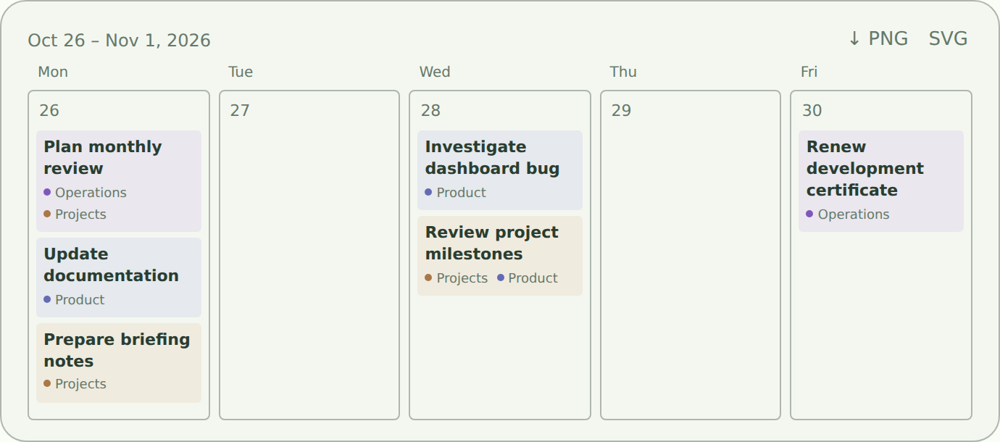
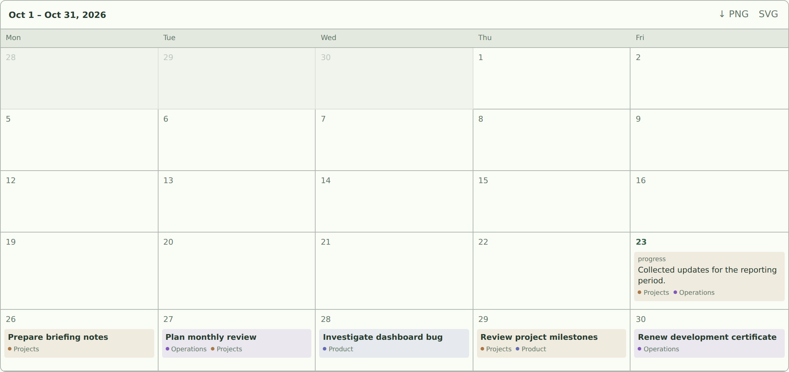
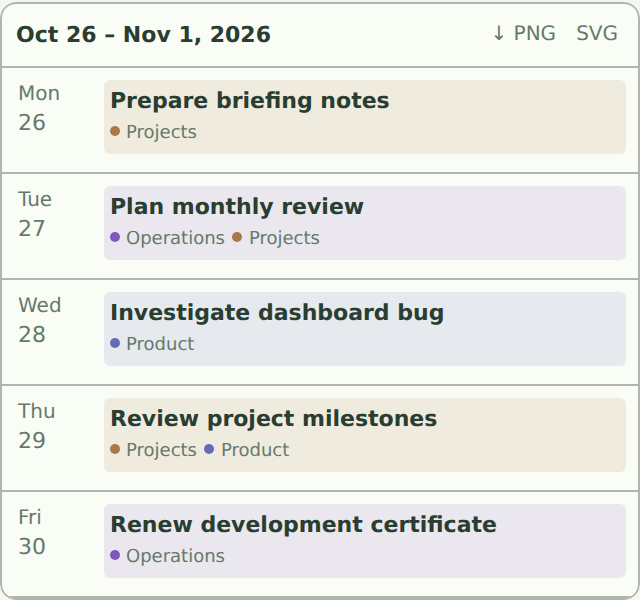

# Tether

Tend is a local-first assistant for keeping track of things you're thinking about, working on, or need to revisit. Talk to it normally; it organizes tasks and remembers context in a local SQLite database.

## Screenshots

The screenshots below use example data, not anyone's personal tasks. They are generated by the [screenshot workflow](.github/workflows/screenshots.yml).

**Conversation**


**Calendar requested in chat (synthetic example data)**



**Month calendar (weekends appear only when they contain tasks or activity)**



These calendars are generated from local task data and appear inside the assistant's themed chat bubble. Day cells have borders and transparent interiors; task blocks keep their category-colored backgrounds. You can request a calendar naturally with `give me my next week snapshot` or `/snapshot last month`.

**On a phone**



**Tasks**


**Task details**


**Archive**


## Install Tether with pip

Requires Python 3.11 or newer. Install the same package on Windows, macOS, or Linux:

```sh
python -m pip install tether
```

**Option A — run as a local server:** `tether serve` opens the browser UI at
`http://127.0.0.1:8765` and starts the local MCP server on port 8766.

```sh
tether serve --port 9000 --mcp-port 9001
tether serve --no-browser
```

For safety the services bind to loopback only; they are not exposed to the network.
Use Ctrl+C to stop the terminal-launched instance.

**Option B — install a desktop shortcut:** the same pip installation can create a
desktop launcher without PyInstaller, administrator privileges, or a separately built
Windows executable:

```sh
tether desktop install
tether desktop install --destination "/path/to/shortcuts"
```

The default location is the operating system's Desktop folder. On Windows this is a
native `.lnk` shortcut to the installed Python interpreter; on macOS it is a
`.command` launcher, and on Linux a `.desktop` entry. The shortcut starts the local
server and opens the browser. macOS may require approving a downloaded/local script
on first launch; Linux desktop environments may require marking the launcher trusted.
Use a persistent Python environment when creating shortcuts, since shortcuts refer
to that interpreter.

Existing Tend installations keep their existing local database in `~/.tend`,
and the legacy `tend` CLI remains an alias during migration.

### Persistent desktop mode with uv (recommended)

Install once, without PyInstaller or a separately downloaded executable:

```sh
uv tool install 'tether[desktop]'
tether-desktop
```

This exposes `tether-desktop` globally from uv's isolated Python environment. On Windows it opens a native WebView window with a persistent system-tray menu; closing the window hides it while **Exit Tether** ends the tray and its background services. On macOS and Linux it opens the browser-based UI and attempts to keep the services running from a system-tray menu; tray support depends on the desktop environment and is not yet verified across distributions. Add `tether-desktop` to your operating system's login/startup applications if you want it available after each sign-in. Creating a shortcut is optional: `tether desktop install` generates one in Desktop or a custom folder. For shortcut creation from an isolated tool install, run `uv tool run --from 'tether[desktop]' tether desktop install` or install the desktop extra into the current environment.

## Legacy Windows native installer (optional)

The original `install-desktop.ps1` builds an optional native WebView2 app.
**It is not required** for the pip install or desktop shortcut above.

## Install on Windows

You need **Python 3.11 or newer**, **Git**, and the **Microsoft Edge WebView2 Runtime** (usually already installed on Windows 10/11).

Open PowerShell:

```powershell
git clone https://github.com/briday1/Tend.git
cd Tend
py -3 -m venv .venv
.\.venv\Scripts\python.exe -m pip install -e .
powershell -ExecutionPolicy Bypass -File .\install-desktop.ps1
```

The installer builds a native **Tend.exe** and creates a **Tend** shortcut on your desktop. Launch Tend from that shortcut. It starts the local services automatically, without requiring an open PowerShell window.

When you close the app window, Tend stays in your system tray. Choose **Open Tend** to reopen it or **Exit Tend** to stop the app and its services.

## First-time setup

Open **Settings → AI connection**. Enter your provider's HTTPS API base URL, model name, and API key, then save and test the connection. The model must support OpenAI-compatible chat-completions tool calling. Your key is stored in your operating system's credential vault, not the Tend database.

## Using Tend

- **Conversation:** Describe things to remember, ask what's outstanding, or tell Tend when something changes.
- **Tasks:** Select a category, search tasks, change statuses and dates, or log activity. A task can belong to several categories; it appears once in **All Tasks** and in each matching category.
- **Reminders and recurring tasks:** Set *Bring to attention* and repeating schedules. A task can also have a linked activity-report action.
- **Archive:** Put finished or inactive tasks away without deleting them; restore them later.
- **MCP:** Other trusted local tools can access the same Tend data through `http://127.0.0.1:8766/mcp`.

Example things to say: “Remind me to follow up next Thursday,” “What am I waiting on?”, “Summarize the week's Projects,” or “Archive that task.”

## Updating

For ordinary Tend updates, choose **Exit Tend** from the system tray, then run `git pull` inside your Tend folder and relaunch the shortcut. If the **native Windows app or its dependencies** changed, rerun `install-desktop.ps1` to rebuild `Tend.exe`.

## Calendar snapshots and AI skill

Ask for a calendar in Conversation, for example `give me my next week snapshot` or `/snapshot last month`. The response contains a compact calendar that fits its own content. Click a task for read-only details; use **PNG** or **SVG** to download it. Change tasks in **Tasks** or by chatting with Tend. Monday–Friday stay visible; weekends appear when they contain tasks or recorded activity. Historical task states are not reconstructed from current values.

The repository includes a natural-language [`/snapshot` agent skill](skills/tend-snapshot/SKILL.md) for compatible AI clients. Register that skill in your AI client separately. Tend's MCP tools return all category memberships, calendar links, and PNG/SVG download links. Use `set_task_categories` to add, remove, or replace memberships. Category filters match any membership; overall counts use unique tasks. PNG downloads default to 2×; the API also supports 1× and 4×.

## More information

See [detailed documentation and troubleshooting](docs/DEVELOPMENT.md) for server setup, database backups, MCP configuration, development, and debugging.

To refresh the screenshot gallery, run **Actions → Refresh Tend UI screenshots → Run workflow** in GitHub. Screenshots appear here after that workflow generates and commits them.
